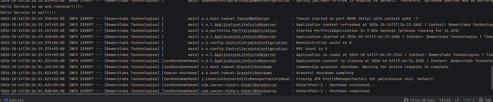

# Spring Boot Starter Experiments

A small experimental project exploring Spring Boot auto-configuration, application lifecycle observation, controller discovery, and bean initialization.

## Experiments

- **Controller discovery:** Counts beans annotated with `@RestController` and `@Controller` when the application starts.
- **Application lifecycle:** Registers an `ApplicationLifeCycleObserver` bean to experiment with application lifecycle events.
- **Bean initialization:** Uses `@PostConstruct` to observe when the `HelloService` bean and its configuration class are initialized.
- **Background execution:** Demonstrates running a simple task on a separate Java thread.

## Run Output

The following screenshot shows the console output produced while running the example application.



## Purpose

This project is a learning sandbox for exploring Spring Boot internals and experimenting with ideas that may inform future starter libraries and application diagnostics tools.

It is not intended to be a production-ready starter.

## Requirements

- Java
- Spring Boot
- Gradle for building and publishing the starter locally
- Maven or Gradle for consuming the published dependency

## Build and Publish Locally

Clone the repository, navigate to the project directory, and publish the starter to your local Maven repository:

```bash
./gradlew publishToMavenLocal
```

This publishes the artifact to your local Maven repository, typically located at `~/.m2/repository`.

Artifact coordinates:

- **Group ID:** `com.enthuzd`
- **Artifact ID:** `springboot-starter-example`
- **Version:** `0.1.0-SNAPSHOT`

## Using with Maven

Add the dependency to your application's `pom.xml`:

```xml
<dependency>
    <groupId>com.enthuzd</groupId>
    <artifactId>springboot-starter-example</artifactId>
    <version>0.1.0-SNAPSHOT</version>
</dependency>
```

Maven resolves the artifact from your local repository when available.

## Using with Gradle

For Gradle projects using Groovy DSL:

```groovy
repositories {
    mavenLocal()
    mavenCentral()
}

dependencies {
    implementation 'com.enthuzd:springboot-starter-example:0.1.0-SNAPSHOT'
}
```

For Gradle projects using Kotlin DSL (`build.gradle.kts`):

```kotlin
repositories {
    mavenLocal()
    mavenCentral()
}

dependencies {
    implementation("com.enthuzd:springboot-starter-example:0.1.0-SNAPSHOT")
}
```

**Note:** `mavenLocal()` is intended here for local experimentation and should generally not be relied on for production dependency resolution.

## Running the Example

Add the dependency to a Spring Boot application and run it.

Inspect the logs and console output to observe controller counts, initialization messages, lifecycle activity, and background-thread execution.

## Notes

- Since `@RestController` is meta-annotated with `@Controller`, REST controllers may be included in both counts.
- The background-thread example is for experimentation only. Production applications should generally use managed execution facilities when background work needs lifecycle management.
- Publish the snapshot artifact locally before consuming it from another project.

## License

Add a license if you intend to make the project available for reuse.# springboot-starter-example
